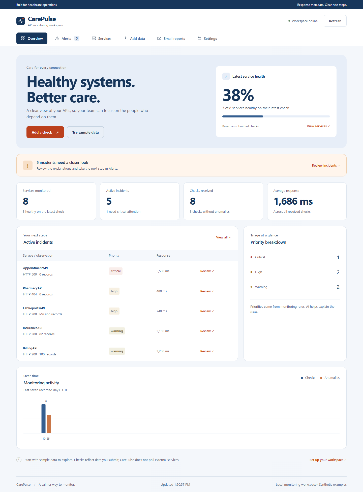
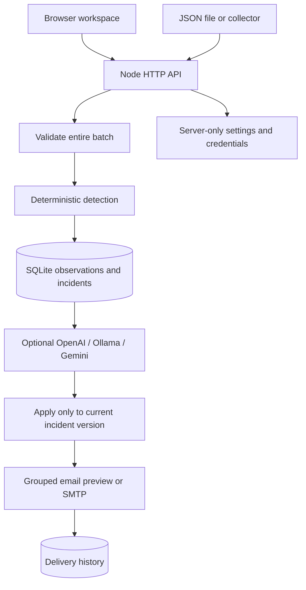

# CarePulse

**API health, clearly.** A small monitoring workspace that turns response metrics into actionable incidents—with OpenAI or local Ollama explanations and optional email reports.

Built for the Care Guide **Intelligent API Monitoring & Alert System** assessment. Native Node.js, SQLite and plain browser JavaScript keep the system easy to run and inspect.



## Run locally

Requires **Node.js 22.16+**; Node.js 24 is recommended for this checkout. SQLite is included in Node. Install dependencies once:

```sh
npm ci
npm start
```

Open **http://127.0.0.1:3000**. Select **Try sample data** to create synthetic incidents, or **Add data** to enter a service check using the regular form. No API key is required to explore the app. Default email mode creates local previews and sends nothing.

Optional environment setup:

```powershell
# Windows PowerShell
Copy-Item .env.example .env
```

```sh
# macOS / Linux
cp .env.example .env
```

The **Settings** page configures AI and email without editing files. Saved settings in `data/settings.json` override environment defaults for those features; server host, port, thresholds and write key still come from the environment. Restart after changing `.env`. To return AI/email settings to environment defaults, stop the server and remove only `data/settings.json`.

## What it does

- Accepts individual checks, pasted JSON, imported JSON files or `POST /monitor` batches.
- Detects failed requests, slow responses, unexpected redirects and missing or zero records.
- Stores observations and incident history in SQLite. Repeated anomalies update one active incident per service; healthy checks automatically resolve it.
- Explains incidents with OpenAI, local Ollama, retained Gemini support or explicit built-in fallback text.
- Creates one email digest per batch containing newly opened incidents. Repeated anomalies do not resend the same open incident. Operators can also create a report of all active incidents.
- Shows service health, incident history, activity and email outcomes in a responsive interface with keyboard navigation, visible focus states and reduced-motion support.

Checks describe **submitted response metadata**. This prototype does not poll external APIs or ingest patient records. Zero records and redirects can be legitimate; production monitoring needs service-specific expectations.

## Connect an AI provider

### OpenAI

1. Open **Settings → Explanation provider → OpenAI**.
2. Enter your API key and an available model; the initial model is `gpt-4.1-mini`.
3. Save, then select **Test saved AI connection**.
4. Add a new anomalous check. The incident identifies the explanation as OpenAI-generated.

The server calls the [Chat Completions API](https://developers.openai.com/api/reference/resources/chat/subresources/completions/methods/create). Keys never reach browser settings responses. A cloud test can incur API usage charges.

Environment equivalent:

```dotenv
AI_PROVIDER=openai
OPENAI_API_KEY=your-key
OPENAI_MODEL=gpt-4.1-mini
```

### Local Ollama

Install [Ollama](https://ollama.com), keep its server running, and install a model:

```sh
ollama pull llama3.2:3b
```

Choose **Ollama** in Settings, use `http://127.0.0.1:11434` and `llama3.2:3b`, then save and test. Any compatible installed chat model can be entered. CarePulse uses Ollama’s native [`POST /api/chat`](https://docs.ollama.com/api/chat) with streaming disabled; no cloud API key is needed. The address is relative to the **CarePulse server**, so `localhost` inside a container refers to that container.

```dotenv
AI_PROVIDER=ollama
OLLAMA_BASE_URL=http://127.0.0.1:11434
OLLAMA_MODEL=llama3.2:3b
AI_TIMEOUT_MS=60000
```

A real local call to `llama3.2:3b` was verified on 24 October 2026. OpenAI/Gemini serialization and error paths are tested with test doubles; no live cloud call has been verified in this revision.

### Failure behavior

Monitoring rules decide incidents and severity. AI only writes explanations from aggregate telemetry. A failed, malformed or timed-out AI response keeps the incident and uses a labeled fallback. Up to four requests run concurrently under a shared configurable batch time budget. Model availability and output quality depend on the selected provider and model.

## Email reports

Choose a mode in **Settings → Email mode**:

| Mode             | Behavior                                                                                                        |
| ---------------- | --------------------------------------------------------------------------------------------------------------- |
| Preview, default | Save a readable report in the workspace. Never send email. A synthetic recipient is used if none is configured. |
| SMTP             | Deliver reports to the configured recipient using your email provider. Record acceptance or failure.            |
| Off              | Do not generate reports.                                                                                        |

For SMTP, enter the recipient, verified sender, server, port and credentials. Port **587** normally uses STARTTLS; port **465** normally requires **Immediate TLS**. Encryption is required by default. Use an app password if your provider requires one. See [Nodemailer SMTP configuration](https://nodemailer.com/smtp).

```dotenv
EMAIL_MODE=smtp
EMAIL_TO=operations@example.com
EMAIL_FROM=monitor@example.com
SMTP_HOST=smtp.example.com
SMTP_PORT=587
SMTP_SECURE=false
SMTP_REQUIRE_TLS=true
SMTP_USER=monitor@example.com
SMTP_PASSWORD=your-app-password
```

**Email reports** shows previews, sent messages and failures. SMTP failure does not discard incident data. A `sent` status means the SMTP server accepted the message; it does not prove inbox delivery. Failed reports are retained; use **Send report** to create a new current summary after fixing settings. There is no durable background retry worker.

## Detection rules

| Condition                                                 | Code              | Priority |
| --------------------------------------------------------- | ----------------- | -------- |
| HTTP 500–599                                              | `HTTP_5XX`        | Critical |
| HTTP 400–499                                              | `HTTP_4XX`        | High     |
| HTTP 300–399                                              | `HTTP_3XX`        | Warning  |
| Response strictly above `SLOW_THRESHOLD_MS`, default 2000 | `SLOW_RESPONSE`   | Warning  |
| Missing or null record count                              | `MISSING_RECORDS` | High     |
| Zero records                                              | `ZERO_RECORDS`    | Warning  |

All matching issues are combined. The most severe rule determines priority. Manual resolution closes the incident but does not change the last received service observation; a new unhealthy check can open a new incident.

## API example

```sh
curl -X POST http://127.0.0.1:3000/monitor \
  -H 'Content-Type: application/json' \
  --data-binary @samples/api-responses.json
curl 'http://127.0.0.1:3000/alerts?status=active'
```

```powershell
$body = Get-Content .\samples\api-responses.json -Raw
Invoke-RestMethod 'http://127.0.0.1:3000/monitor' -Method Post -ContentType 'application/json' -Body $body
```

Or run `npm run demo` and `npm run recover` while the server is running. If write protection is enabled, include `x-api-key`; browser users enter the key in Settings. Full routes and example responses: [API reference](docs/API_REFERENCE.md).

## Architecture



Network calls run **after** the SQL transaction. Optimistic incident versions prevent slow AI responses from overwriting a newer observation. Settings are snapshotted at the start of each batch. Source comments explain the purpose of modules, queries and important lines.

| Location                                | Responsibility                                                              |
| --------------------------------------- | --------------------------------------------------------------------------- |
| `src/server.js`                         | HTTP routes, limits, write authorization, static files and security headers |
| `src/validation.js`, `src/detection.js` | Input contract, anomaly rules and accurate fallback wording                 |
| `src/db.js`, `src/monitor.js`           | Persistence, incident lifecycle, transactions and bounded enrichment        |
| `src/llm.js`                            | Provider requests, prompt, timeout, provenance and fallback                 |
| `src/settings.js`, `src/email.js`       | Validated local settings, secret redaction and notification outcomes        |
| `web/`                                  | Responsive, build-free interface                                            |
| `tests/`                                | Unit, integration, SMTP and browser verification                            |
| `docs/`                                 | Requirements, architecture, learning material and submission support        |

See [architecture decisions](docs/ARCHITECTURE.md) and the [code walkthrough](docs/CODE_WALKTHROUGH.md).

## Verification

```sh
npm run check
npm test
npx playwright install chromium
npm run test:browser
npm run format:check
```

To use an existing Chrome installation on Windows:

```powershell
$env:PLAYWRIGHT_CHROMIUM_EXECUTABLE_PATH='C:/Program Files/Google/Chrome/Application/chrome.exe'
npm run test:browser
```

The browser suite exercises desktop and mobile workflows, real HTTP routes and automated WCAG checks across six views. Unit tests use no cloud keys or external recipients; SMTP integration uses a loopback mail sink. GitHub Actions is configured for Node.js 22 and 24. Local results and limitations are recorded in [TEST_RESULTS.md](docs/TEST_RESULTS.md); CI status must be checked after publication.

## Assessment and project notes

- [Assessment coverage](docs/ASSESSMENT_REQUIREMENTS.md)
- [AI assistance disclosure](docs/AI_PROMPTS_DISCLOSURE.md) and required [AI_Prompts.docx](AI_Prompts.docx); regenerate with `npm run docs:prompts` using Python 3.
- [Video walkthrough script](docs/VIDEO_SCRIPT.md) and [submission checklist](docs/SUBMISSION_CHECKLIST.md)
- [Contributing](CONTRIBUTING.md), [security notes](SECURITY.md), [changelog](CHANGELOG.md)
- [Mobile screenshot](docs/screenshots/mobile.png)

This is a single-process assessment prototype. Read APIs are unauthenticated; local settings contain plaintext credentials protected by the operating system, not encryption. Keep the default loopback binding. Public deployment needs authentication, TLS, access controls and a notification queue. No production-healthcare or compliance claims are made. All examples and screenshots use synthetic metadata.
